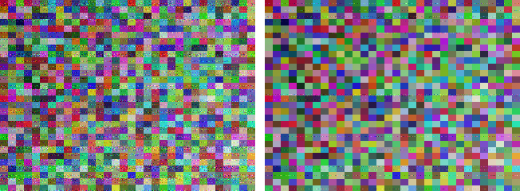

# SSTV Stacker

**Combine repeat copies of an SSTV picture into one better copy. Nothing made up.**

When the same slow-scan TV picture is received several times (an SSTV event on the International Space Station sends the same set of pictures for days), every copy is damaged in different places:
- noisy lines near the start and end of a pass;
- lines never received, where decoding started late or stopped early;
- small shifts between copies;
- now and then, a Robot 36 copy with its colours swapped.

SSTV Stacker finds which of your pictures are copies of the same one, and combines them into one copy that is better than any of them.



*The best of four damaged copies of a made-up test picture (left), and all four combined (right). The estimated noise falls from 12.4 to 4.1 levels.*

## Use it

- **In your browser:** <https://sstv-stacker.netlify.app>.
  1. Choose a folder of pictures.
  2. Look at each result beside its best single copy.
  3. Download them as a zip, or, in Chrome or Edge, save them straight into a folder.

  Everything runs on your own computer, and nothing is uploaded.
- **On the command line:**

  ```
  sstv-stacker <folder> [--out <folder>] [--colour-fix auto|on|off]
  ```

  This files the best copies in `<folder>/Best copies` unless `--out` says otherwise. Run it again after more pictures come in: only pictures with new copies are rebuilt, and a file is replaced only by a better one. The old one moves to `Replaced/`.
- **In your own program:** the `sstv-stacker` crate (source at <https://github.com/paulamihc/sstv-stacker>). Use `group` and `combine` on pictures, `batch::run` on files in memory, or `folder::update` on a folder.

It reads PNG, JPEG and BMP pictures from any decoder (for example MMSSTV, QSSTV, the Robot36 app or Station Controller). A folder can hold many different pictures, with folders inside it.

## Nothing made up

1. **Every pixel comes from your copies.**
   - At each place, the copies that agree are averaged, weighted by how cleanly each line came in, so every value lies between the lowest and highest your copies hold there.
   - There's no AI, no filling in, no upscaling and no guessing between lines.
   - Nothing comes from the web.
2. **A line no copy received stays missing,** drawn as a grey hatched band.
3. **Only decoding errors are undone:** copies are lined up (a shift of a few pixels), and swapped Robot 36 colours are put back.

**What's kept and recorded:**
- **Details:** each combined picture keeps its strongest copy's details unchanged (PNG text fields such as time, frequency and callsign, and a JPEG's EXIF and comment). Four fields are added: `Combined from`, `Strongest copy`, `Coverage` and `Combined by`.
- **A record** in `Records/` says which copies were used, how each was shifted and corrected, and where each line came from.
- **Pictures received once** are passed on exactly as they were.
- **Your originals** are never changed.

## How it works

1. **Grouping.** Copies are compared at a quarter of their size, so speckle averages out.
   - Parts that a whole series of pictures shares (a frame, logos, callsigns) are found and left out of the comparison. Otherwise every slide of a series would match every other.
   - A copy joins a group only on a clear match.
   - Two copies that share too few received lines aren't compared at all.
2. **Lining up.** Each copy is shifted (up to 10 pixels across and 6 up or down) to line up with the best one.
3. **Colours.** A vote among the copies finds any Robot 36 copy with its colours swapped, and puts it back. This is only done for Robot 36 pictures unless you ask for it, because other modes can't swap like that.
4. **Weighting.** Each line of each copy is weighted by its noise, measured against the other copies where there are three or more, or else by its own roughness.
5. **Combining.** At each pixel, the most central copy is found, copies far from it are left out, and the rest are averaged by weight.
6. **Sizes.** A copy saved at an exact multiple of another's size (say 640 by 480 beside 320 by 240) is averaged down to match. Other sizes are never combined.

## Build it

```
cargo test --workspace
cargo build --release -p sstv-stacker-cli     # the command line
rustup target add wasm32-unknown-unknown
./web/build.sh                                # the web page, into web/dist
node web/serve.mjs                            # try it on http://localhost:8737
```

The library has no dependencies without its `files` feature. With it (the default), it uses `png`, `jpeg-decoder`, `serde` and `serde_json`, all under MIT or Apache 2.0 licences. The web page uses no libraries or other sites.

## Licence

Copyright 2026 Paul Friend.

Licensed under either the [Apache License, Version 2.0](LICENSE-APACHE) or the [MIT licence](LICENSE-MIT), at your option. Unless you say otherwise, any contribution you submit for inclusion is licensed the same way, with no additional terms.

Contributions and bug reports are welcome. Please don't send real pictures with other people's callsigns in them as test material: the tests use made-up pictures.
